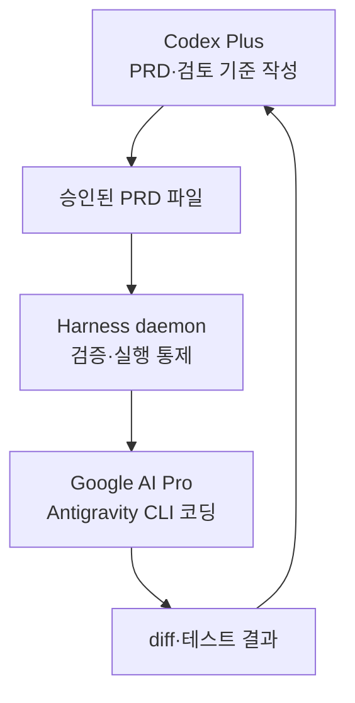
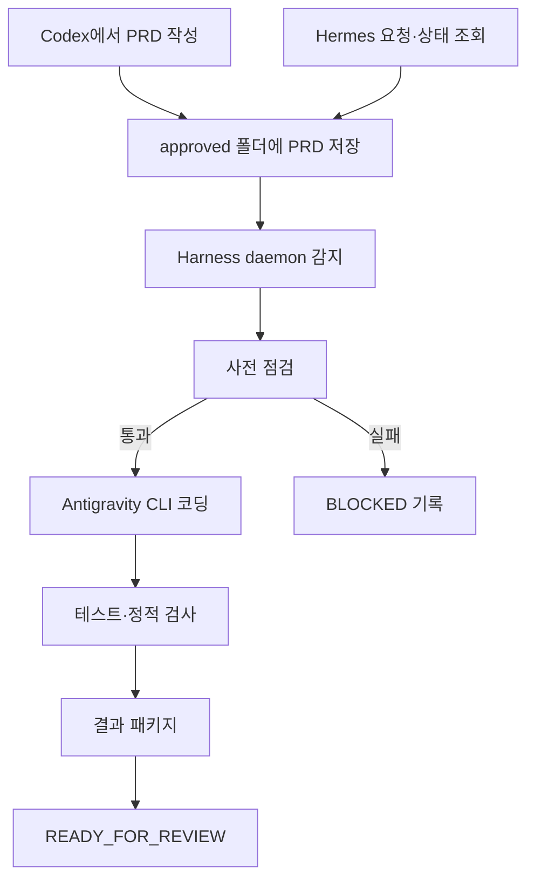

# 무과금 자동 하네스 개발 구조 PRD

## 1. 목적

ChatGPT Plus와 Google AI Pro의 **기존 구독 범위** 안에서 개발 작업을 반자동으로 수행하는 하네스를 만든다. 사용자가 PRD를 작성·승인하면 데몬이 해당 문서를 감지하고, Gemini 기반 코딩 CLI를 실행해 코드 수정과 테스트까지 진행한다. Hermes는 작업 요청·상태 알림·원격 명령의 진입점으로만 사용한다.

> 핵심 원칙: 외부 LLM API를 호출하지 않는다. `OPENAI_API_KEY`, `GEMINI_API_KEY`, `GOOGLE_API_KEY`, `ANTHROPIC_API_KEY`는 요구·생성·사용하지 않는다.

## 2. 전제와 현실적인 범위

| 구분 | 역할 | 실행 방식 |
| --- | --- | --- |
| Codex (ChatGPT Plus) | PRD 구성, 작업 분할, 결과 검토 기준 작성 | 사용자가 Codex 대화에서 작성한 내용을 파일로 저장 |
| Hermes | 작업 접수, 상태 조회·알림, 선택적 승인 명령 전달 | 기존 로그인 세션과 gateway 사용 |
| Antigravity CLI | 코드 분석·수정·테스트를 수행하는 Gemini 기반 코더 | Google AI Pro로 로그인된 CLI 실행 |
| Harness daemon | PRD 감시, 사전 점검, CLI 호출, 로그·상태 관리 | 로컬 Python 데몬/systemd user 서비스 |

## 3. 구독별 책임 분리

### A. Codex Plus 영역 — PRD 설계와 사람 검토 지원

Codex는 **코드 실행 데몬이 아니라 설계·검토 도구**로 사용한다. Codex에서 생성한 결과는 사용자가 검토한 뒤 PRD 파일로 저장하며, 데몬은 Codex 세션이나 계정에 직접 접속하지 않는다.

| Codex Plus가 담당하는 일 | 산출물 | 데몬과의 연결 방식 |
| --- | --- | --- |
| 요구사항 정리와 작업 분할 | `inbox/`의 초안 PRD | 사용자가 파일로 저장 |
| 수정 범위·금지 범위·완료 기준 정의 | 승인 가능한 PRD | 사용자가 검토 후 `approved/`로 이동 |
| 테스트 시나리오와 검토 체크리스트 작성 | `acceptance`, `tests` 항목 | 데몬이 해당 항목만 읽어 실행 |
| 실행 결과의 diff·테스트 로그 해석 | 사람 검토 의견, 후속 PRD | 다음 작업을 새 PRD로 작성 |

**Codex Plus 영역의 금지 사항**

- Codex API 키·자동 API 호출을 사용하지 않는다.
- Codex가 로컬 데몬을 직접 기동하거나 Hermes 자격 증명에 접근하지 않는다.
- 대화 결과만으로 자동 승인·자동 commit·자동 배포하지 않는다.

### B. Google AI Pro 영역 — Gemini 기반 코딩 실행

Google AI Pro는 **Antigravity CLI 로그인 세션을 통해 코드 분석·수정·테스트 보조**에 사용한다. 데몬은 승인된 PRD를 표준 프롬프트로 변환해 CLI에 전달하고, CLI의 출력·종료 코드·변경 범위만 통제한다.

| Google AI Pro가 담당하는 일 | 실행 주체 | 결과 |
| --- | --- | --- |
| 저장소 코드 읽기와 구현안 작성 | Antigravity CLI | 워크트리 변경 |
| PRD 범위 내 코드 수정 | Antigravity CLI | `diff.patch` |
| 실패 원인·수정 요약 출력 | Antigravity CLI | `stdout.log`, `stderr.log` |
| 사용량 한도·로그인 상태 반영 | 데몬이 감지·기록 | `QUOTA_BLOCKED`, `AUTH_REQUIRED` |

**Google AI Pro 영역의 금지 사항**

- Gemini SDK, Google AI API, Vertex AI API를 호출하지 않는다.
- `GEMINI_API_KEY`, `GOOGLE_API_KEY`를 생성·주입·fallback으로 사용하지 않는다.
- OAuth 로그인, 동의, 결제 또는 사용량 한도 해제를 자동화하지 않는다.
- CLI 한도를 넘거나 초과 과금 방지 설정을 확인할 수 없으면 작업을 즉시 중단한다.

### C. 역할 경계



- Codex Plus → 데몬: **파일로 전달**한다. API나 세션 자동화는 하지 않는다.
- 데몬 → Google AI Pro: **Antigravity CLI 하위 프로세스**로만 전달한다. SDK/API는 사용하지 않는다.
- Hermes → 데몬: 작업 상태·알림·중단 요청만 전달한다. 코드 작성 역할은 갖지 않는다.

### 3.1 Gemini SDK 직접 호출은 제외

Gemini SDK는 일반적으로 Google AI API 키 또는 Vertex AI 자격 증명을 사용하므로, AI Pro 구독만으로 “추가 결제 없이 SDK 자동 호출”을 보장할 수 없다. 따라서 이 PRD의 실행기는 **SDK가 아니라 로그인된 Antigravity CLI**다. 데몬은 CLI를 하위 프로세스로 실행하고 표준 출력·종료 코드만 관리한다.

또한 Gemini CLI는 2026-06-18 이후 Antigravity CLI로 전환되었으므로, 신규 구조는 Antigravity CLI를 기준으로 한다. 실제 설치 버전별 명령 옵션은 bootstrap 시 `--help`로 확인해 capability 파일에 기록하고, 확인되지 않은 옵션은 호출하지 않는다.

### 3.2 가능한 자동화와 불가능한 자동화

| 항목 | 처리 |
| --- | --- |
| PRD 감지, 작업 폴더 생성, 코드 CLI 실행, 테스트 실행, 로그·결과 저장 | 자동 |
| 로그인, OAuth 동의, 비밀번호·토큰 입력, 구독 결제 | 사용자 수동 |
| API 키 fallback, 유료 API 호출, 크레딧/overage 사용 | 절대 금지 |
| git commit, push, 배포, DB 변경·마이그레이션 | 기본 금지, 별도 승인 PRD에서만 허용 |
| 사용량 한도 도달 후 재시도 | 즉시 중단하고 `QUOTA_BLOCKED` 상태로 기록 |

## 4. 목표와 비목표

### 목표

1. 승인된 PRD만 처리한다.
2. 작업마다 입력, 실행 로그, 변경 파일, 테스트 결과를 남긴다.
3. 소스·테스트·로그를 분리하고 한 작업이 다른 작업을 덮어쓰지 않게 한다.
4. CLI 사용량 제한, 인증 만료, 충돌, 테스트 실패를 안전하게 중단·복구한다.
5. Hermes로 작업 상태를 확인하고 필요 시 다음 작업을 넣을 수 있게 한다.

### 비목표

- 무인 상태에서 결제·인증·권한 승인을 우회하는 것
- 사람 검토 없이 운영 환경에 배포하는 것
- 여러 작업을 동시에 같은 저장소에 적용하는 것
- API 기반 멀티에이전트 오케스트레이션

## 5. 전체 흐름



## 6. 디렉터리 규격

```text
project-root/
├─ .harness/
│  ├─ inbox/                 # 작성 중 PRD. 데몬은 무시
│  ├─ approved/              # 실행 승인된 PRD
│  ├─ running/               # 현재 처리 중인 PRD
│  ├─ done/                  # 완료/검토대기 PRD
│  ├─ failed/                # 차단·실패 PRD
│  ├─ state/
│  │  ├─ capabilities.json   # 도구/옵션 탐지 결과
│  │  ├─ jobs.json           # 작업 상태 인덱스
│  │  └─ lock.json           # 단일 실행 잠금
│  ├─ runs/<job-id>/
│  │  ├─ input.md            # 실행 당시 원문 PRD 사본
│  │  ├─ prompt.md           # CLI에 전달한 정규화 프롬프트
│  │  ├─ stdout.log
│  │  ├─ stderr.log
│  │  ├─ test.log
│  │  ├─ diff.patch
│  │  └─ result.json
│  └─ config.yaml
├─ docs/prd/                 # 장기 보관 PRD
└─ <application source>
```

`approved/`로 이동하는 행위가 실행 승인이다. 데몬은 `inbox/`의 문서를 실행하지 않는다.

## 7. PRD 파일 계약

PRD는 UTF-8 Markdown이며 YAML front matter를 필수로 둔다.

```markdown
---
id: seatmate-20260914-001
title: 좌석 조회 지연 개선
status: approved
repository: /absolute/path/to/repository
branch: feature/seat-query
mode: code_and_test
risk: low
allow_commit: false
allow_push: false
allow_db_change: false
allow_network: false
tests:
  - npm test -- --runInBand
  - cargo test
acceptance:
  - 반복 조회 시 불필요한 전체 재조회가 발생하지 않는다.
  - 기존 API 응답 형식과 화면 동작을 유지한다.
---

## 문제와 목표

문제, 재현 조건, 기대 결과를 구체적으로 작성한다.

## 수정 범위

수정 가능 파일/모듈, 수정 금지 파일, 기존 규칙을 적는다.

## 구현 지시

코더가 수행할 단계와 판단 기준을 적는다.

## 검증 방법

실행할 테스트와 수동 확인 항목을 적는다.
```

### 필수 검증 규칙

- `id`는 작업마다 고유해야 한다.
- `status: approved`가 아니면 실행하지 않는다.
- `repository`는 허용 저장소 목록 아래의 절대 경로여야 한다.
- `branch`가 현재 브랜치와 다르면 자동 checkout하지 않고 `BLOCKED` 처리한다.
- `allow_*`는 명시하지 않으면 모두 `false`다.
- `risk: high` 또는 DB·배포·권한 변경은 데몬 실행 대상에서 제외한다.

## 8. 데몬 상세 설계

### 8.1 실행 주기와 단일 작업 원칙

- 30~60초 간격으로 `approved/`를 확인한다. 파일 시스템 감시가 불안정한 환경에서는 polling을 기본으로 한다.
- 프로세스 잠금과 `lock.json`을 함께 사용하여 한 번에 한 작업만 처리한다.
- 실행 전 PRD를 `running/`으로 **원자적 이동**한다. 데몬 재시작 시 `running/`의 작업은 재실행하지 않고 `INTERRUPTED`로 표시해 사용자가 재승인한다.
- 같은 PRD의 해시와 `id`가 이미 처리됐으면 중복 실행하지 않는다.

### 8.2 bootstrap 사전 점검

데몬 시작 시 아래를 확인하고 `.harness/state/capabilities.json`에 기록한다.

1. `git`, `antigravity`, `hermes` 명령 존재 여부
2. 각 명령의 `--version` 및 `--help` 결과
3. 현재 저장소의 git 상태와 원격 URL 존재 여부
4. Antigravity 로그인 세션 유효 여부를 **읽기 전용 상태 명령**으로 확인할 수 있는지
5. `config.yaml`의 API 차단 값과 위험 작업 차단 값

점검 실패는 자동 복구하거나 재로그인을 시도하지 않는다. 상태는 `AUTH_REQUIRED` 또는 `TOOL_UNAVAILABLE`로 남긴다.

### 8.3 실행 절차

1. PRD 스키마·허용 경로·금지 작업을 검증한다.
2. 저장소가 깨끗한지 확인한다. 이미 변경이 있으면 `DIRTY_WORKTREE`로 중단한다.
3. 작업 전 `git status --short`, `git diff`, 현재 commit SHA를 run 폴더에 저장한다.
4. PRD를 정규화한 `prompt.md`를 만든다. 여기에는 수정 범위, 금지 범위, 테스트, 완료 조건, commit/push 금지를 포함한다.
5. capability 파일에 검증된 **비대화형 프롬프트 실행 옵션**만 사용해 Antigravity CLI를 실행한다.
6. CLI 종료 후 변경 파일이 PRD의 허용 범위를 벗어났는지 검사한다. 벗어나면 `SCOPE_VIOLATION`으로 분류한다.
7. 선언된 테스트와 포맷/정적 검사를 실행한다.
8. `git diff --binary`를 `diff.patch`로 저장하고 `result.json`을 생성한다.
9. 성공·실패와 관계없이 PRD를 `done/` 또는 `failed/`로 이동하고 Hermes 상태 알림을 시도한다.

### 8.4 코드 CLI에 전달할 표준 프롬프트

```text
당신은 이 저장소의 구현 담당자다.
PRD에 명시된 수정 범위 안에서만 작업하라.
비밀값, API 키, 결제 설정, 인증 파일을 생성·수정·출력하지 마라.
git commit, push, 배포, DB 스키마 변경을 하지 마라.
구현 전 관련 코드를 읽고, 가장 작은 수정으로 요구사항을 충족하라.
완료 후 PRD의 테스트를 실행하고 실패 원인과 변경 파일을 요약하라.
불확실하거나 범위를 벗어나는 요구는 수정하지 말고 BLOCKED 사유를 출력하라.
```

## 9. 상태 모델과 재시도

| 상태 | 의미 | 다음 조치 |
| --- | --- | --- |
| `QUEUED` | 승인 PRD 감지 | 사전 점검 |
| `RUNNING` | 코더 또는 테스트 실행 중 | 상태 조회만 허용 |
| `READY_FOR_REVIEW` | 변경·테스트 결과 생성 | 사용자가 diff와 테스트 로그 검토 |
| `TEST_FAILED` | 코드 실행은 끝났으나 테스트 실패 | 원인 수정용 신규 PRD 작성 |
| `BLOCKED` | 범위·환경·도구 조건 미충족 | 원인 해결 후 재승인 |
| `AUTH_REQUIRED` | 로그인 세션 없음/만료 | 사용자가 직접 로그인 |
| `QUOTA_BLOCKED` | AI Pro/CLI 사용량 한도 도달 | 사용량 회복 후 신규 승인 |
| `INTERRUPTED` | 데몬·PC 종료 등으로 중단 | PRD 검토 후 다시 approved로 이동 |

자동 재시도는 네트워크성 CLI 실패에 한해 최대 1회, 5분 뒤에만 허용한다. 인증 오류·사용량 제한·명령 옵션 오류는 재시도하지 않는다.

## 10. 과금 차단 규칙

`config.yaml`의 기본값은 다음과 같다.

```yaml
api_policy:
  deny_environment_variables:
    - OPENAI_API_KEY
    - GEMINI_API_KEY
    - GOOGLE_API_KEY
    - ANTHROPIC_API_KEY
  deny_api_key_files: true
  deny_api_fallback: true
  deny_credit_overage: true
  require_cli_login_session: true

execution_policy:
  max_concurrent_jobs: 1
  max_cli_attempts_per_job: 1
  max_job_minutes: 30
  allow_commit: false
  allow_push: false
  allow_deploy: false
  allow_db_change: false
  allow_network: false
  require_clean_worktree: true
  allowed_repositories: []
```

실행 래퍼는 시작 전에 금지 API 키 환경 변수가 존재하면 값을 노출하지 않고 즉시 종료한다. Antigravity 설정에서 신용/초과 사용 전략이 설정 가능한 경우에는 `never`만 허용한다. 설정을 판별할 수 없다면 실행하지 않고 `BILLING_GUARD_UNVERIFIED`로 중단한다.

## 11. Hermes 연동 규칙

Hermes는 코드를 직접 수정하지 않는다. 다음의 제어·관찰 기능만 맡는다.

| 기능 | 처리 방식 |
| --- | --- |
| 작업 접수 | 승인된 PRD 파일의 경로 또는 ID 전달 |
| 상태 조회 | `jobs.json`과 `result.json`의 요약만 반환 |
| 알림 | `READY_FOR_REVIEW`, `TEST_FAILED`, `BLOCKED` 발생 시 요약 발송 |
| 승인 | 사용자가 `approved/`로 이동시키는 방식이 기준. Hermes 명령은 보조 수단 |
| 중단 | 현재 하위 프로세스에 종료 신호 전송 후 `INTERRUPTED` 기록 |

Hermes gateway/cron은 데몬을 여러 번 기동하는 용도로 사용하지 않는다. 데몬은 systemd user 서비스 한 개로 상시 실행하고, Hermes cron이 필요하면 **상태 요약 알림**만 수행한다. 이렇게 해야 중복 실행과 기존 cron 충돌을 막을 수 있다.

## 12. 보안·운영 통제

- `.harness/runs/`, `.harness/state/`, `.env`, 인증 캐시, 로그의 비밀값은 git 추적에서 제외한다.
- 코더 프롬프트와 결과에는 토큰·쿠키·비밀번호·개인정보를 남기지 않는다.
- 실행 계정은 해당 프로젝트 디렉터리만 수정할 수 있도록 최소 권한을 부여한다.
- production 설정, DB 접속 정보, SSH 키, 배포 파이프라인 파일은 기본 수정 금지 목록에 넣는다.
- 테스트 명령은 allowlist로 관리한다. PRD에 임의의 `curl`, `rm`, 패키지 전역 설치, 권한 변경 명령을 넣어도 실행하지 않는다.
- 작업 시간 초과 시 자식 프로세스 그룹을 종료하고 원인을 `TIMEOUT`으로 저장한다.

## 13. 결과물 규격

`result.json`에는 아래 정보만 저장한다.

```json
{
  "job_id": "seatmate-20260914-001",
  "status": "READY_FOR_REVIEW",
  "started_at": "2026-09-14T01:00:00Z",
  "finished_at": "2026-09-14T01:12:00Z",
  "repository": "/absolute/path/to/repository",
  "base_commit": "<sha>",
  "changed_files": ["src/example.rs"],
  "tests": [{"command": "cargo test", "exit_code": 0}],
  "artifacts": ["stdout.log", "stderr.log", "test.log", "diff.patch"],
  "next_action": "diff.patch와 test.log를 검토한 뒤 사람이 commit한다"
}
```

## 14. 완료 기준

1. `approved/`의 정상 PRD 하나가 한 번만 처리된다.
2. 허용되지 않은 PRD, 더러운 worktree, 만료된 로그인, quota 소진은 코드 변경 없이 중단된다.
3. 실행마다 입력·출력·테스트·diff·상태가 독립 run 폴더에 남는다.
4. API 키를 넣지 않은 환경에서 CLI 로그인 세션만으로 실행할 수 있다.
5. API 키가 존재하거나 초과 과금 방지 설정을 검증할 수 없으면 실행하지 않는다.
6. 자동 commit/push/deploy/DB 변경이 발생하지 않는다.
7. Hermes에서 작업 ID별 상태와 다음 조치를 확인할 수 있다.

## 15. 단계별 구축 순서

### 1단계 — 안전한 뼈대

- 디렉터리, PRD 파서, 상태 파일, 파일 잠금을 구현한다.
- `--dry-run`에서 PRD 검증과 prompt 생성까지만 수행한다.
- Antigravity/Hermes 명령 탐지와 로그인 상태 확인을 구현한다.

### 2단계 — 단일 저장소 코드 실행

- 허용 저장소 하나만 등록한다.
- Antigravity CLI의 검증된 비대화형 실행 경로를 연결한다.
- timeout, 실행 로그, diff 생성, 테스트 allowlist를 적용한다.

### 3단계 — Hermes 관찰 연동

- 상태 조회와 완료/차단 알림을 연결한다.
- cron은 상태 알림용으로만 제한한다.

### 4단계 — 안정화

- 실패 유형별 테스트를 추가한다: 로그인 만료, quota 소진, 코드 CLI 종료 실패, 테스트 실패, 범위 이탈, 데몬 강제 종료.
- 실제 개발 PRD 한 건으로 `READY_FOR_REVIEW`까지 검증한다.

## 16. 운영 체크리스트

- [ ] Codex에서 PRD를 작성하고 수동 검토했다.
- [ ] `status: approved`, 저장소 경로, 브랜치, 허용 범위, 테스트가 명확하다.
- [ ] 현재 worktree가 깨끗하다.
- [ ] 사용자가 Antigravity와 Hermes 로그인을 직접 완료했다.
- [ ] API 키·유료 API fallback·초과 과금이 차단돼 있다.
- [ ] 결과는 `READY_FOR_REVIEW`에서 사람이 diff와 테스트 로그를 검토한다.
- [ ] 사람의 명시적 판단 뒤에만 commit, push, 배포를 수행한다.

## 17. 결정 요약

- **Codex는 설계자**: PRD와 검토 기준을 만든다.
- **Antigravity CLI는 코더**: Gemini 기반 코드 실행을 담당한다.
- **데몬은 집행자**: 승인 PRD만 단일 큐로 실행하고 결과를 보관한다.
- **Hermes는 관제 채널**: 요청·상태·알림만 맡고 코드 수정 권한을 갖지 않는다.
- **무과금의 핵심**: SDK/API 호출을 하지 않고, CLI 로그인 세션과 구독 한도 안에서만 동작하며, 한도·인증·초과과금 조건에서는 즉시 멈춘다.
