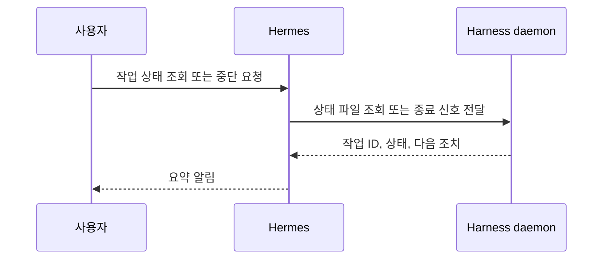

# Hermes 연동 PRD

## 1. 목적

Hermes를 자동 하네스의 **관제 채널**로 사용한다. Hermes는 PRD의 실행 상태를 조회하고, 완료·실패·차단을 알리며, 사용자가 요청한 중단 신호를 데몬에 전달한다.

Hermes는 코드를 작성·수정하지 않으며, Google AI Pro 또는 Codex의 인증 정보에 접근하지 않는다.

## 2. 역할과 권한

| 기능 | 허용 동작 | 금지 동작 |
| --- | --- | --- |
| 작업 접수 | PRD ID·경로 안내 | PRD 내용 자동 승인 |
| 상태 조회 | `jobs.json`, `result.json` 요약 반환 | 로그 전체·비밀값 반환 |
| 알림 | 완료·실패·차단 요약 발송 | 오류를 숨긴 성공 알림 |
| 중단 | 현재 작업에 종료 요청 전달 | 작업 후 자동 재실행 |
| 스케줄 | 상태 요약 알림 | 데몬을 중복 기동하는 cron |

## 3. 연동 흐름



PRD 실행 승인의 기준은 사용자가 PRD를 `approved/` 폴더로 이동시키는 것이다. Hermes 명령은 상태 확인과 알림의 보조 채널이며, 승인 우회 수단이 아니다.

## 4. 상태 조회 응답 규격

```json
{
  "job_id": "seatmate-20260914-001",
  "status": "READY_FOR_REVIEW",
  "started_at": "2026-09-14T01:00:00Z",
  "finished_at": "2026-09-14T01:12:00Z",
  "changed_files": ["src/example.rs"],
  "tests": [{"command": "cargo test", "exit_code": 0}],
  "next_action": "diff와 테스트 로그를 사람이 검토"
}
```

출력에서 제외할 항목:

- 토큰·쿠키·API 키·비밀번호
- `.env` 원문과 인증 파일 내용
- 장문의 표준 출력 전체
- 개인 정보와 DB 접속 문자열

## 5. 알림 조건

| 상태 | 알림 내용 | 사용자 다음 조치 |
| --- | --- | --- |
| `READY_FOR_REVIEW` | 변경 파일 수, 테스트 결과, 결과 경로 | diff·로그 검토 |
| `TEST_FAILED` | 실패한 테스트와 종료 코드 | 원인 분석용 후속 PRD 작성 |
| `BLOCKED` | 차단 유형과 해결 조건 | 환경·PRD 수정 후 재승인 |
| `AUTH_REQUIRED` | 로그인 필요 도구명만 표시 | 사용자가 직접 로그인 |
| `QUOTA_BLOCKED` | 사용량 한도 도달 | 사용량 회복 뒤 새 작업 승인 |
| `INTERRUPTED` | 중단 시점과 저장된 결과 경로 | 재검토 후 다시 승인 |

## 6. 운영 요구사항

- 데몬은 systemd user 서비스 하나로 운영한다.
- Hermes cron은 1개 이하의 상태 요약 알림용으로만 사용한다.
- gateway 재시작·오류가 있어도 PRD 실행을 자동으로 여러 번 요청하지 않는다.
- Hermes 실패는 하네스 결과를 성공으로 바꾸지 않는다. 알림 실패만 별도 기록한다.
- 허용된 사용자 ID만 상태 조회·중단 요청을 할 수 있다.

## 7. 완료 기준

- 사용자는 작업 ID 하나로 현재 상태와 다음 조치를 확인할 수 있다.
- 완료·실패·차단 시 짧은 요약 알림이 전달된다.
- Hermes를 통해 코드 수정·승인 우회·인증 자동화·과금 설정 변경이 불가능하다.
- 중단 요청은 현재 실행만 멈추고 자동 재실행하지 않는다.
