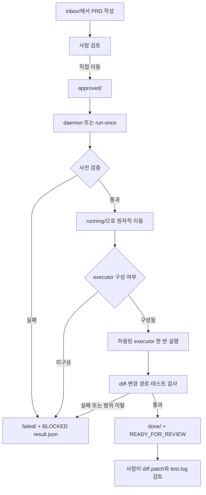

# PRD 기반 구현 정리

- 작성일: 2026-09-14
- 프로젝트: `E:/python/prd-harness`
- 기준 문서: Harness Daemon PRD, Hermes 연동 PRD, PRD 템플릿, PRD 검토 체크리스트
- 제외 범위: 특정 공급자 기반 코더·SDK·API 키·로그인·결제 자동화 연동

## 1. 구현 목적

승인된 저위험 PRD를 감지해 한 번에 하나씩 처리하고, 사전 안전 검증·결과 보관·diff·테스트 기록·중단 제어를 제공하는 로컬 하네스를 구현했다.

Hermes는 관제 채널로만 사용한다. Hermes는 PRD 승인, 코드 수정, executor 인증, 자동 재시작을 수행하지 않는다.

## 2. 구현 범위와 파일

| 구분 | 파일 | 구현 내용 |
| --- | --- | --- |
| 핵심 하네스 | `src/prd_harness/core.py` | PRD 파싱, 승인 검증, 파일 잠금, 단일 처리, 중단, 결과 보관, diff·테스트 검사 |
| CLI | `src/prd_harness/__main__.py` | `init`, `run-once`, `daemon`, `status`, `stop` 명령 |
| PRD 템플릿 | `templates/PRD_TEMPLATE.md` | 구조화된 frontmatter, `allowed_paths`, 테스트, 완료 조건 |
| 검토 체크리스트 | `templates/REVIEW_CHECKLIST.md` | 승인 전 범위·위험·테스트·worktree 점검 |
| Hermes 관제 문서 | `docs/HERMES_INTEGRATION.md` | 상태 조회·중단 권한과 금지 범위 |
| Windows 실행 예시 | `scripts/run-daemon.cmd` | 수동 daemon 시작 템플릿, 자동 등록 없음 |
| 테스트 | `tests/test_harness.py` | 승인·범위·중단 복구·결과 보관 회귀 테스트 |

## 3. 처리 흐름



## 4. 하네스 상태 디렉터리

```text
.harness/
├─ inbox/       # 작성 중 PRD, 실행하지 않음
├─ approved/    # 사용자 승인 후 실행 대기
├─ running/     # 현재 실행 중인 PRD
├─ done/        # READY_FOR_REVIEW PRD
├─ failed/      # BLOCKED, TEST_FAILED, INTERRUPTED PRD
├─ runs/<job-id>/
│  ├─ input.md
│  ├─ prompt.md
│  ├─ stdout.log
│  ├─ stderr.log
│  ├─ test.log
│  ├─ diff.patch
│  └─ result.json
└─ state/
   ├─ capabilities.json
   ├─ jobs.json
   └─ lock.json
```

## 5. PRD 사전 검증 구현

승인 PRD는 아래 조건을 모두 충족해야 실행 단계로 이동한다.

| 검증 항목 | 구현 결과 |
| --- | --- |
| `status: approved` | 필수. draft 등은 `BLOCKED` |
| `risk: low` | low 이외 값은 `BLOCKED` |
| `allow_commit`, `allow_push`, `allow_db_change`, `allow_network` | 모두 `false`가 아니면 `BLOCKED` |
| PRD ID | 소문자 slug 형식 검사 |
| 저장소 | CLI에서 지정한 정확한 allowlist 저장소만 허용 |
| 브랜치 | 현재 브랜치와 PRD의 `branch` 일치 필요 |
| worktree | `git status --porcelain`이 비어 있어야 함 |
| 수정 범위 | `allowed_paths` 비어 있지 않아야 함 |
| 테스트 | 선언된 테스트가 allowlist 접두사에 포함되어야 함 |
| 민감 환경 | `*_API_KEY` 환경 변수 또는 저장소 `.env` 발견 시 executor 차단 |

테스트 명령 allowlist 기본값은 다음과 같다.

```text
python -m unittest
python -m pytest
pytest
npm test
cargo test
```

## 6. 실행·변경·결과 보관 구현

### 단일 실행과 중복 방지

- `state/lock.json`을 `O_CREAT | O_EXCL` 방식으로 만들며 동시 daemon 실행을 막는다.
- 발견한 PRD는 `approved/`에서 `running/`으로 원자적 이동 후 처리한다.
- 동일 PRD ID와 동일 SHA-256 내용 해시는 재실행하지 않는다.
- daemon 재기동 시 `running/`에 남은 PRD는 `INTERRUPTED`로 기록하고 `failed/`로 이동한다.

### 변경 범위 검사

executor 종료 후 아래를 모두 수집한다.

- unstaged 변경
- staged 변경
- untracked 파일
- binary diff

변경 파일이 `allowed_paths` 밖이면 코드를 자동으로 되돌리지는 않는다. 대신 diff를 보존하고 `BLOCKED`로 종료해 사람이 검토·되돌리도록 한다. 자동 복구 중 유효한 변경까지 잃는 것을 방지하기 위한 정책이다.

### 결과 상태

| 상태 | 처리 결과 |
| --- | --- |
| `READY_FOR_REVIEW` | 허용 범위의 변경 및 선언 테스트 성공. 자동 배포·commit 없음 |
| `TEST_FAILED` | 선언 테스트 실패. 실패 로그와 diff 보관 |
| `BLOCKED` | PRD·환경·executor·범위 조건 미충족 |
| `INTERRUPTED` | 중단 요청, 시간 초과, 또는 재기동 감지 |

모든 결과는 `runs/<job-id>/result.json`과 `state/jobs.json`에 축약 상태로 기록한다.

## 7. Hermes 연동 범위

Hermes에 허용된 동작은 다음 두 가지다.

```bash
# 축약 상태 조회
python -m prd_harness --root <harness-root> status --job-id <job-id>

# 현재 RUNNING 작업 하나에 stop 요청
python -m prd_harness --root <harness-root> stop <job-id>
```

Hermes는 다음을 수행하지 않는다.

- PRD를 `approved/`로 이동하거나 자동 승인
- executor 설정·로그인·인증 처리
- 코드 수정
- daemon 중복 기동 또는 중단 뒤 자동 재실행
- 로그 전문, 환경 변수 원문, 인증 파일·토큰·비밀번호 표시

## 8. executor 현재 상태

현재 executor는 기본값으로 **미설정**이다.

이는 하네스의 PRD 검증·상태·로그·테스트·diff 관리 기능은 동작하지만, 실제 코드 변경 도구는 아직 연결하지 않았다는 뜻이다. 승인 PRD가 사전 검증을 통과하더라도 executor가 없으면 코드 변경 없이 아래처럼 종료한다.

```text
status: BLOCKED
reason: executor is not configured
```

특정 코더를 연결하려면 별도 검토를 거쳐 `--executor`에 로컬 명령을 명시해야 한다. 연결 전제는 다음과 같다.

- 전용 로컬 계정 또는 최소 권한 workspace
- allowlisted 저장소 외 쓰기 권한 제거
- 자동 commit/push/deploy 비활성화
- 작업 후 사람이 `diff.patch`, `test.log`, `result.json` 검토

## 9. 검증 결과

아래 명령을 실제 실행했다.

```bash
PYTHONPATH=src python -m unittest discover -s tests -p 'test_*.py' -v
PYTHONPATH=src python -m compileall -q src tests
git diff --check
```

결과:

```text
Ran 4 tests
OK
```

회귀 테스트로 확인한 항목:

1. draft PRD는 executor를 실행하지 않고 `BLOCKED` 처리된다.
2. 허용 경로 변경은 `READY_FOR_REVIEW`, diff·테스트 로그·결과 파일을 남긴다.
3. 범위 밖 파일 변경은 `BLOCKED` 처리되고 diff는 보존된다.
4. daemon 재시작 시 `running/` PRD는 자동 재실행되지 않고 `INTERRUPTED` 처리된다.

## 10. 운영 시 다음 단계

1. 대상 저장소별로 `.harness/`를 초기화한다.
2. PRD 템플릿과 체크리스트로 low-risk 작업만 승인한다.
3. executor 연결 여부와 최소 권한 실행 계정을 별도 승인한다.
4. 실제 executor 연결 전에는 `run-once`로 사전 검증 결과를 먼저 확인한다.
5. `READY_FOR_REVIEW`가 생성돼도 사람이 diff와 테스트 로그를 확인하기 전에는 commit, push, 배포를 진행하지 않는다.
